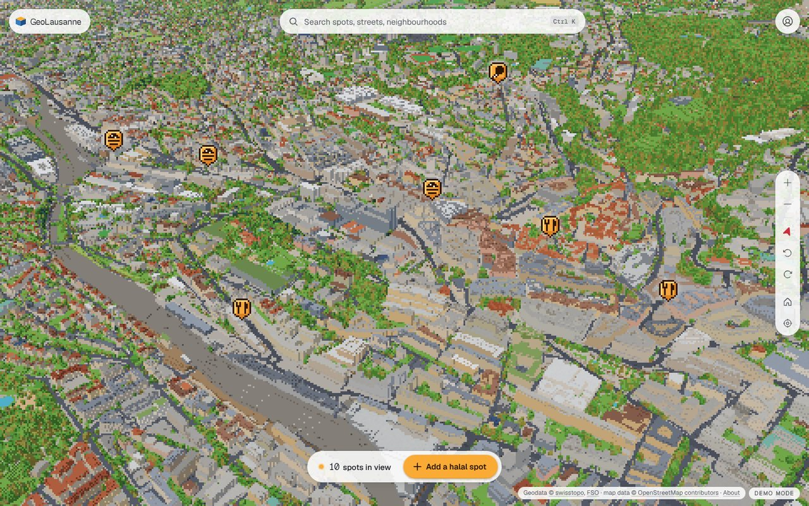
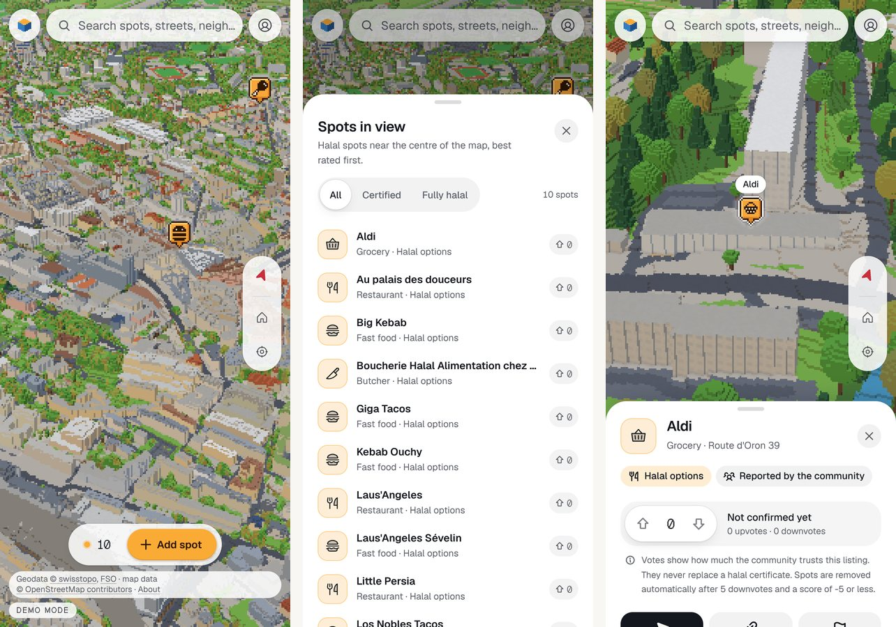

# GeoLausanne

A voxelised 3D Lausanne where the community maps **halal food**: explore the
whole city block by block, find spots, vote on them (a spot that enough
people judge wrong is removed), review them and say how you checked the halal
status.



* **Real Lausanne, blocky look**: terrain, buildings with their roofs,
  streets, every tree and the lake of Lausanne and its 15 neighbouring
  municipalities (Renens, Ecublens, Pully, Epalinges…), built offline from
  swisstopo open data, the federal building register and OpenStreetMap into a
  streamed quadtree of 10 540 tiles (1–8 m voxels). Roofs take their colour
  from the aerial photo, facades from their construction period, all drawn as
  pixel art under Lausanne's real sky.
* **A living city**: spots are pixel-art badges showing their category; the
  lake's boats run on the real timetable (the Évian shuttles, the paddle
  steamer to Vevey), gulls circle Ouchy and pigeons the cathedral, clouds
  drift, the sun follows Lausanne's clock and night lights the windows.
* **A calm interface over it** ("Diorama"): islands and a dock in warm paper
  and ink, Geist with pixel accents, panels that keep the city in view (the
  map recentres beside them), small motions that confirm what changed.
* **Community trust, not certification**: votes measure trust in a listing;
  only a moderator-checked certificate is shown as verified.
* **Accessible**: WCAG 2.2 AA target, keyboard model for the 3D map with
  spoken feedback, a list alternative, a Reduce motion switch, forced-colour
  support, Base UI primitives, axe checks in CI.
* **Private**: no tracking, pseudonymous names, location stays on the device.
* **Free to run**: Vercel, Cloudflare Pages and Supabase free tiers.
* French and English, light and dark (night) modes.



## Quick start

```bash
bun install
bun dev        # http://localhost:3000
```

No configuration needed: without a Supabase project the app runs in **demo
mode** (data in your browser, the Lausanne-Flon demo city, instant sign-in;
an e-mail starting with `mod` gets the moderator role). Details in
[docs/getting-started.md](docs/getting-started.md).

## Repository

| Path | Contents |
| --- | --- |
| [`apps/web`](apps/web) | Next.js 16 app: React Three Fiber city, Base UI interface, next-intl |
| [`packages/geo-types`](packages/geo-types) | LV95/WGS84 transforms, tile maths, manifest schema |
| [`pipelines/geodata`](pipelines/geodata) | `geovox`, the Python pipeline from geodata to voxel tiles |
| [`supabase`](supabase) | database migrations (RLS, RPC API, moderation), seed, pgTAP tests |
| [`docs`](docs) | architecture, pipeline, decisions, design, operations |

## Documentation

Everything is in [`docs/`](docs/README.md): an [overview](docs/overview.md)
with the milestone status, how the [streaming](docs/architecture/streaming-and-lod.md)
and the [pipeline](docs/pipeline/README.md) work, the [data model](docs/backend/data-model.md),
27 [decision records](docs/decisions/README.md), the [design system](docs/design/design-system.md)
and [accessibility](docs/design/accessibility.md) notes, and the
[deployment](docs/operations/deployment.md) guide.

## Tests

```bash
bun run typecheck && bun run lint && bun run test     # types, lint, unit tests
bun run build && bun run test:e2e                     # Playwright + axe
cd pipelines/geodata && pytest                        # pipeline
bash scripts/test-db.sh                               # pgTAP (PostgreSQL 16 + PostGIS + pgTAP)
```

All of them run in CI on every push.

## Data and licences

Code: [MIT](LICENSE). Geodata © [swisstopo](https://www.swisstopo.admin.ch)
(open government data); map data © [OpenStreetMap contributors](https://www.openstreetmap.org/copyright)
(ODbL). Facts added by the community are published under the ODbL. See
[docs/legal/data-licensing.md](docs/legal/data-licensing.md).
